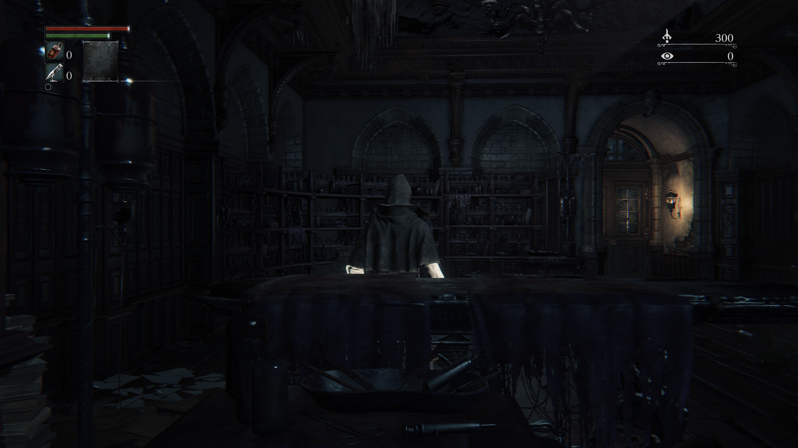

# Paleblood

*Bloodborne, rebuilt as readable code that runs natively on a PC.*

**[Start here](https://github.com/Yharnam-Hunters/Paleblood/issues/31)** ·
**[Documentation](https://yharnam-hunters.github.io/byrgenwerth-site/)** ·
[Discussions](https://github.com/Yharnam-Hunters/Paleblood/discussions) ·
[Contributing](CONTRIBUTING.md)

  

Iosefka's Clinic with correct lighting, drawn by Paleblood's own renderer on Linux from the maintainer's own copy of the game (a local test build, 13 November 2026), at full resolution. Bloodborne © Sony Interactive Entertainment / FromSoftware.

## What this is

Paleblood rewrites Bloodborne's code by hand as readable source, one function at a time, and runs
it natively on a PC (Linux; macOS is on the way). Every rewritten function is tested against the
original to prove it behaves the same. It is not an emulator, and it contains no part of the game:
you bring your own copy.

## Status

**The game is not playable yet.** In local test runs it starts up, goes through the title screen,
menus and character creation, and loads the first area, Iosefka's Clinic.

**Details:** [full numbers](STATUS.md) · [how it works and what works](docs/OVERVIEW.md) ·
[the story so far](https://yharnam-hunters.github.io/byrgenwerth-site/runtime/) ·
[contributors](https://yharnam-hunters.github.io/byrgenwerth-site/hunters/)

## Try it

You need Linux and a dump of your own copy of the game from your own PS4. Build with CMake, then
follow [docs/OVERVIEW.md](docs/OVERVIEW.md#running-the-game) to boot the game in a window, or
[docs/ONBOARDING.md](docs/ONBOARDING.md) to set up for development.

## Help out

Everyone is welcome: rewrite a function, work on the runtime, or write up how a system works.
Read [CONTRIBUTING.md](CONTRIBUTING.md) and pick a task from [Start here](https://github.com/Yharnam-Hunters/Paleblood/issues/31).

## Legal

- **No game files.** This repository holds only newly written code, tools and documentation; the
  checks refuse game data.
- **Your own copy.** You need Bloodborne (CUSA03173, EU) with the 1.09 update, dumped from your
  own PS4. We never provide or link to game files, firmware, keys or decryption tools.
- **Not affiliated** with, endorsed by or sponsored by Sony Interactive Entertainment or
  FromSoftware. Bloodborne and related names are trademarks of their respective owners; the
  frames shown here are theirs, drawn by Paleblood's own renderer and shown for technical
  commentary.

Full text: [docs/LEGAL.md](docs/LEGAL.md).

## License

GPL-2.0-or-later ([LICENSE](LICENSE)). Bundled third-party code keeps its own license
(`third_party/README.md`); none of it grants any right in the game.

*Fear the old blood.*
