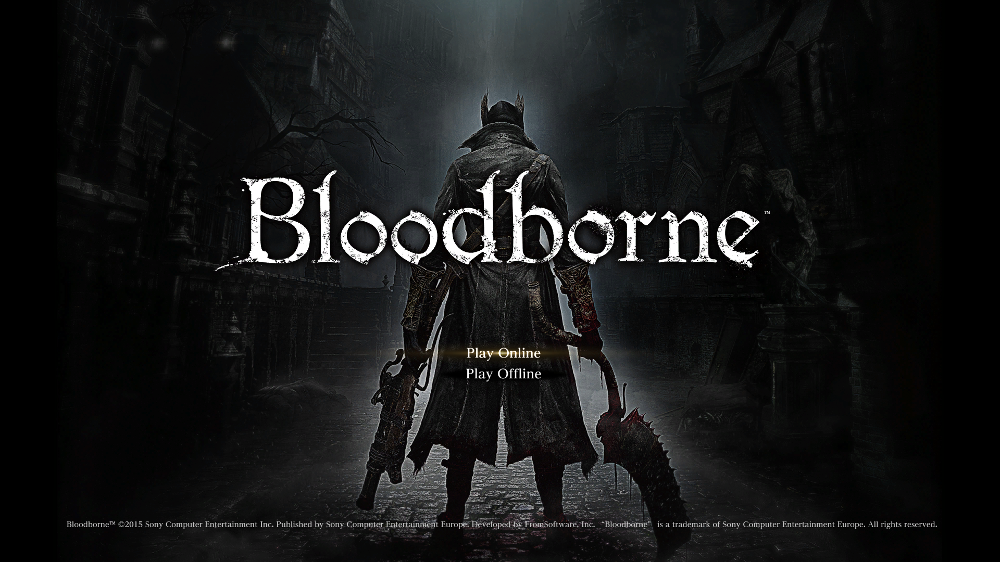
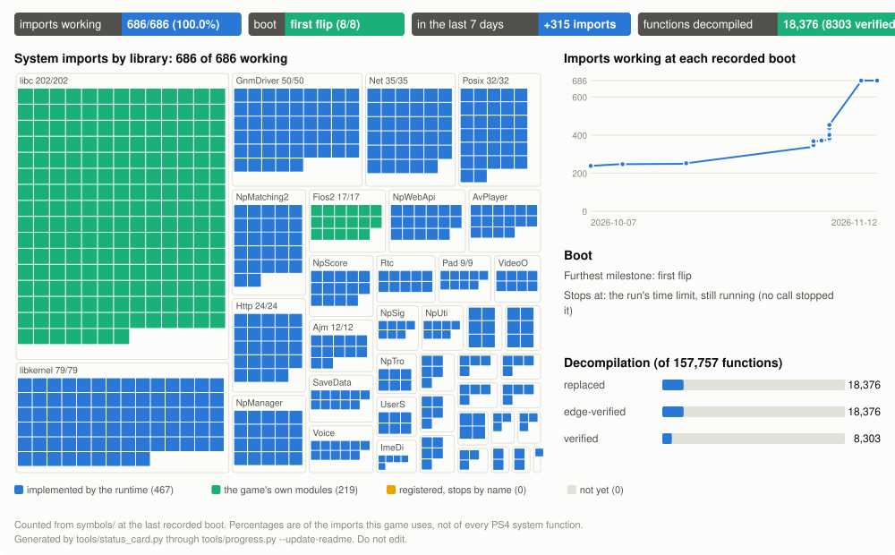

# Paleblood

*Bloodborne, rewritten as readable C++ one verified function at a time, running natively on a PC on a runtime of its own.*

<!-- status:start -->
The game doesn't run on Paleblood yet: 21 of 157757 functions are verified (0.01%). On [our own runtime](runtime/) the executable's boot gets as far as the run's time limit, still running (no call stopped it), with 453 of 686 system imports implemented.
<!-- status:end -->

**[Start here](https://github.com/Yharnam-Hunters/Paleblood/issues/31)** ·
**[Documentation](https://yharnam-hunters.github.io/byrgenwerth-site/)** ·
[Discussions](https://github.com/Yharnam-Hunters/Paleblood/discussions) ·
[Contributing](CONTRIBUTING.md)

<p align="center">
  
</p>
<p align="center"><sub>The game's own title screen, drawn on Linux by Paleblood's runtime and renderer from the maintainer's own copy (6 November 2026), at full resolution. Bloodborne © Sony Interactive Entertainment / FromSoftware; shown as a technical milestone.</sub></p>

## What this is

Paleblood is two things built side by side:

- **A decompilation.** The game's 1.09 PS4 executable is rewritten as readable C++, function by
  function. It is a *functional* decompilation: a replacement does not have to compile to the same
  bytes, it has to **behave** exactly like the original, and each one is proved to, against the
  original itself.
- **A native runtime.** The game's x86-64 code runs directly on your PC. Paleblood supplies the
  PS4 system libraries it calls (threads, memory, files, sound, video out, the GPU), written from
  public facts. There is no emulator: the GPU is rebuilt at the engine's own level, translating the
  game's shaders and replaying its own draw calls on Vulkan (Metal on macOS in progress).

The goal is a complete source port: every function rewritten and proved, the game running natively
on Paleblood alone, and a game that can be read, preserved, fixed and modded like any other
program. You always bring your own copy of the game.

It is made by people who love this game and want it to outlive the hardware it was made for.

## Where it stands

<picture>
  <source media="(prefers-color-scheme: dark)" srcset="docs/assets/status-dark.svg">
  
</picture>

<!-- progress:start -->
| | Functions | Bytes |
|---|---:|---:|
| Target (Ghidra export) | 157757 | 42487369 |
| Replaced | 162 (0.10%) | 62275 (0.15%) |
| Edge-verified | 162 (0.10%) | 62275 (0.15%) |
| Verified | 21 (0.01%) | 14010 (0.03%) |

Each row includes the next: verified functions are also edge-verified and replaced.

| Runtime | |
|---|---|
| System imports implemented | 453 of 686 (66.03%): 219 by the game's own modules, 234 by the runtime |
| Other imports | 2 registered fail-loud diagnostics, 231 unbound |
| Furthest boot milestone | first flip (8 of 8) |
| Boot stops at | the run's time limit, still running (no call stopped it) |

Generated by `tools/progress.py --update-readme` from `symbols/`. Do not edit.
<!-- progress:end -->

- **The runtime reaches the title screen.** The game boots on Paleblood's own runtime with no call
  stopping it. It plays its company logos and draws its title screen through Paleblood's renderer
  (the game's own compute passes, shaders, textures and draws, on Vulkan). It also plays its movies
  (decoded with FFmpeg), its sound (ATRAC9 through LibAtrac9) and reads a keyboard or gamepad.
- **Getting past the title is next:** pressing "Play Offline", then character creation and the
  first scene, which need much more of the renderer (3D models, lighting, post-processing).
- **The decompilation** covers the frame loop (clock, frame limiter, per-frame step, frame pacing)
  and functions in the event, kernel, input, AI, character, physics and render layers, every one
  proved against the original. `BB_TARGET_FPS=30|60|uncapped` already does in code what the
  community frame-rate patches do with byte edits.
- **The external scaffold** (`third_party/bbport/`) is still kept for full game runs, until
  Paleblood's own runtime passes the same run checks.

What happens next is in [STATUS.md](STATUS.md) and the queue in [NEXT.md](NEXT.md); the
[runtime page](https://yharnam-hunters.github.io/byrgenwerth-site/runtime/) tells the full story.

## Try it

You need Linux (the primary platform, tested by CI) or macOS (in progress), and a dump of your own
copy of the game from your own PS4 (see Legal below).

```
git clone https://github.com/Yharnam-Hunters/Paleblood.git
cd Paleblood
cmake -S . -B build && cmake --build build -j && ctest --test-dir build --output-on-failure
tools/install_hooks.sh
```

Boot the game to its title screen in a window, with sound and controls (Vulkan, SDL3 and FFmpeg
needed):

```
python3 tools/boot.py --no-record --game-lib build/game/libbbgame.so \
    --display window --audio host --input host --timeout 600
```

Keyboard: WASD and the arrow keys are the sticks, IJKL the D-pad, Enter/Space cross, Backspace
circle, R square, F triangle, Q/E L1/R1, Z/C L2/R2, Esc options, T the touch pad; a gamepad works
by button position. Plain `python3 tools/boot.py` (no options) runs without the replacements, display
or sound, and records how far the boot gets.

[docs/ONBOARDING.md](docs/ONBOARDING.md) goes from your own dump to your first pull request:
preparing the dump (`tools/prepare_dump.sh`), Ghidra with the GhidraOrbis loader
([docs/GHIDRA.md](docs/GHIDRA.md)), the verification harness and a first verified function.

## How it works

**Decompilation track**

1. **Map the original.** Our loader ([`runtime/loader.c`](runtime/loader.c)) maps the unmodified
   executable from your own dump: segments, relocations, and every system import bound.
2. **Rewrite a function.** A replacement in `game/<system>/`, readable ([STYLE.md](STYLE.md)) and
   faithful to the original; [`game/hooks.csv`](game/hooks.csv) registers it.
3. **Prove it.** [`tools/verify.py`](docs/VERIFY.md) runs the original machine code and the
   replacement side by side on recorded and generated cases and compares return values,
   registers, every byte written and every library call. Deliberately wrong versions must fail.
4. **Review it.** An independent reviewer checks the verification and the readability before a
   function counts as verified (CONTRIBUTING.md, "Definition of done").

**Runtime track**

5. **System libraries** (`runtime/syslib/`): each PS4 call the game makes is answered from public
   facts, or stops by name. Nothing is guessed.
6. **Renderer** (`runtime/renderer/`, [docs/RENDERER.md](docs/RENDERER.md)): the game's GPU library
   calls are observed at the engine level, its GCN shaders translated to SPIR-V, and its draws and
   compute passes replayed on Vulkan. No command-stream emulation.
7. **Boot further.** `tools/boot.py` measures how far the game gets on the runtime alone.

## Options

| Variable | Effect |
|---|---|
| `BB_TARGET_FPS=30`, `60`, `uncapped` | Frame rate target, as the community "30 FPS++", "60 FPS++" and "Uncap FPS++" patches. Unset: the original behaviour, exactly. |
| `BB_LIMITER_WAIT=sleep` | The frame limiter sleeps instead of spinning while it waits (the game carries this wait but never selects it). |

## Contributing

**Everyone is welcome.** One function or cluster per pull request, verified with
`tools/verify.py`, readable ([STYLE.md](STYLE.md)) and independently reviewed; runtime work is
claimable per system call group (issues labelled `runtime`). Every pull request carries a session
or runtime report that CI checks, along with the build, the tests and the no-game-data rule. Pick a
good first issue or a target from [NEXT.md](NEXT.md), and read [CONTRIBUTING.md](CONTRIBUTING.md)
first.

## Documentation

- **[The documentation site](https://yharnam-hunters.github.io/byrgenwerth-site/)**: how each
  system works, the runtime and renderer story, the devlog, the progress dashboard and the address
  map. No console or game files needed to read it.
- [`docs/systems/`](docs/systems/): one page per game system (generated).
- [docs/ARCHITECTURE.md](docs/ARCHITECTURE.md), [docs/RENDERER.md](docs/RENDERER.md),
  [docs/runtime-syscalls.md](docs/runtime-syscalls.md), [docs/VERIFY.md](docs/VERIFY.md),
  [QUIRKS.md](QUIRKS.md): how the pieces fit, how the renderer works, what each system call does,
  how replacements are proved, and the traps.

## Layout

| Path | What |
|---|---|
| `game/<system>/` | Replacement code, one directory per game system, with its case generators. |
| `game/hooks.csv` | Hook registry: original address to replacement. |
| `runtime/` | The native runtime: loader, boot harness, system libraries (`syslib/`), renderer, display, audio, input. Nothing specific to this game. |
| `symbols/` | `functions.csv` (what we track), `ghidra_functions.csv` (every function, the denominator), boot records. |
| `tools/` | Verification harness, boot harness, progress, validators, Ghidra scripts, hooks. |
| `test/` | Unit and GPU tests; system library tests in `test/syslib/`. |
| `third_party/` | LibAtrac9 (MIT, unmodified) and the external run scaffold, each with its license (`third_party/README.md`). |
| `docs/` | Onboarding, Ghidra setup, architecture, renderer, verification, system pages. |

## Target

CUSA03173 (EU), update v1.09 merged over the base game. Hashes of the executables converted
from SELF to ELF (`target.sha256`); addresses in `symbols/` are PS4 virtual addresses (Ghidra
image base `0x400000`, the same as the community patches). See [QUIRKS.md](QUIRKS.md).

<!-- target:start -->
```
ca8813862d7b1345a6791b7d88cc1d383ede2a6bbc944f39dd3c0e0e3ad9e285  eboot.elf
6552d61af5258817f434c00f759e194c5d97ac97cfc7ce11b1f23aec11f94d0a  libc.elf
8def93e0cd3224619d3d51ddfda8b3dd745e6707d1398fd399d5f04199a7caab  libSceFace.elf
16369566417f7bacd34ebd75f8cffb586563da3e2c40fe8880c60d76718e4833  libSceFios2.elf
6ec2b7bd0cb1dcfe491f3981301c6f30836e34d06e97a1aaaa609580dc2a899a  libSceHand.elf
3f303ae1bd114380729987698b5aa4cfcfeb11d2dc6c9d09f5d6ae9baa53ce18  libSceHeadTracker.elf
b653f26abcf0fd185b4110a6aacc123f7e2e8c0d085f8e5ba1698123213b6659  libSceS3DConversion.elf
a85c286a110f406682dafc97819318eedc9aa1591b79465f1ef9c1929655de8c  libSceSmart.elf
```
<!-- target:end -->

## Legal

- **No game files, ever.** This repository contains no code, assets, binaries, decompiler output
  or extracted data from the game, and never will. What it holds is newly written source, tools
  and documentation. `tools/check_no_game_data.py` runs in the pre-commit hook and in CI and
  rejects anything that looks like game data.
- **Your own console, your own copy.** To build, run or verify anything you need Bloodborne
  (CUSA03173, EU) with the 1.09 update, dumped from your own PS4. The project does not provide
  or point to game files, pkgs, firmware, keys or decryption tools, and requests for or links to
  them are removed ([CONTRIBUTING.md](CONTRIBUTING.md), "Your own copy").
- **Images.** No extracted game images or assets. The images here are our own work: recordings of
  our tools, and frames drawn by Paleblood's own renderer, at full resolution, added by the
  maintainer with attribution (such as the title screen above). The checks refuse anything else.
- **Not affiliated.** This is a fan project. It is not affiliated with, endorsed by or sponsored
  by Sony Interactive Entertainment or FromSoftware. Bloodborne and related names are trademarks
  of their respective owners; the title-screen frame is theirs, shown for technical commentary.

## License

GPL-2.0-or-later ([LICENSE](LICENSE)). LibAtrac9 is MIT; the external run scaffold has its own
GPL-2.0-or-later license and attribution notice in `third_party/README.md`. Neither grants any
right in the game or its code.

*Fear the old blood.*
